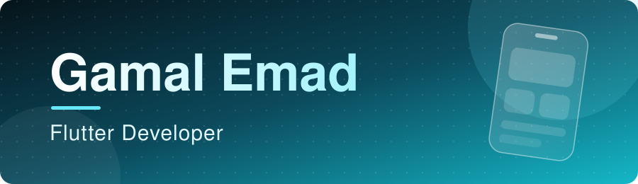

 

---

## About me

I build Flutter apps with Clean Architecture, Cubit (BLoC) and Firebase. NTI and DEPI graduate, studying Computer Science at Menofia University (class of 2027). Open to full-time Flutter roles, internships and freelance projects.

## Tech stack

- **State management:** Cubit / BLoC, Provider
- **Backend:** Firebase Auth, Firestore, Storage, FCM, REST APIs
- **Architecture:** Clean Architecture, Repository pattern

## Featured projects

### [EcoCycle](https://github.com/GamalEmad23/EcoCycle)
DEPI graduation project. Recycling app with pickup requests, map location picker, on-device TFLite material classification, impact charts and an admin dashboard. 
Flutter &middot; BLoC &middot; Firebase

### [Flutter ML Prediction App](https://github.com/GamalEmad23/ml_model)
Mobile client for a FastAPI ML backend: upload datasets, train models, follow training status, inspect predictions. 
Flutter &middot; Dart &middot; REST API

### [Tharad](https://github.com/GamalEmad23/Tharad)
Arabic-first app with full right-to-left layout and reusable custom widgets. 
Flutter &middot; Dart

### [StockPulse](https://github.com/GamalEmad23/StockPulse) &middot; [live](https://gamalemad23.github.io/StockPulse/)
Web app I built to log my own trades, with login, trade dashboard and light/dark modes. 
Web

## Let's connect

